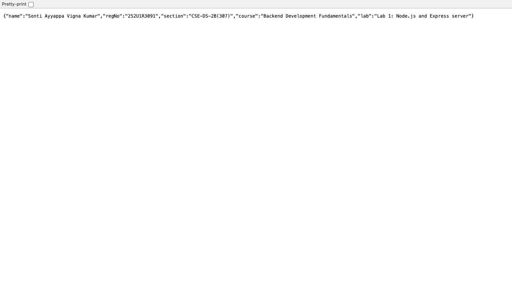
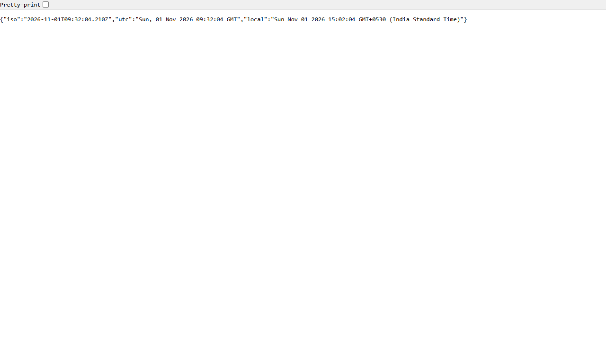
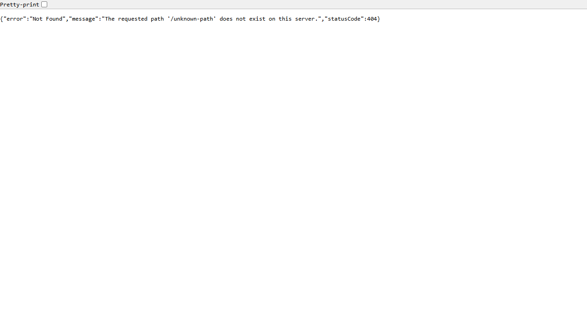

# Lab 1: Node.js and Express server

**Student Name:** Sonti Ayyappa Vigna Kumar · **Registration Number:** 252U1R3091 · **Section:** CSE-DS-2B(307)  
**Course:** Backend Development Fundamentals (Year II Term II) · **Faculty:** Yugandhar Sir · **Institution:** Aurora Deemed to be University  
**Repository Link:** [https://github.com/ayyappasonti99-stack/Backend-Development-Fundamentals-Labs](https://github.com/ayyappasonti99-stack/Backend-Development-Fundamentals-Labs)  
**Live Link:** [https://backend-development-fundamentals-labs.vercel.app](https://backend-development-fundamentals-labs.vercel.app) *(or Not applicable / pending deployment)*

---

## Table of Contents
1. [Objective](#objective)
2. [Explanation of package.json Fields](#explanation-of-packagejson-fields)
3. [How to Run](#how-to-run)
4. [Endpoints and Scripts Table](#endpoints-and-scripts-table)
5. [Route Status Codes (Task 7)](#route-status-codes-task-7)
6. [Screenshots of Working Endpoints](#screenshots-of-working-endpoints)
7. [Notes: Problems Faced & Solutions](#notes-problems-faced--solutions)
8. [Viva Questions & Answers](#viva-questions--answers)

---

## Objective
Set up a Node.js project and build a modular web server, first using Node's built-in `http` module and then rewritten using the `Express` framework with routing, status code handling, and 404 fallback handling.

---

## Explanation of `package.json` Fields
When initializing a Node.js project with `npm init -y`, `package.json` is generated as the project manifest. Below is an explanation of each field:

| Field | Purpose / Description |
| :--- | :--- |
| `"name"` | The lowercase, URL-friendly unique identifier/name for this Node.js package or project (e.g., `"lab-1"`). |
| `"version"` | Follows Semantic Versioning (`MAJOR.MINOR.PATCH`, e.g., `"1.0.0"`). Tracks release iterations. |
| `"description"` | A brief human-readable summary of the package/project purpose. |
| `"main"` | The primary entry point file of the application that gets executed when the package is required or imported (e.g., `"index.js"`). |
| `"scripts"` | Custom terminal alias scripts that can be invoked via `npm run <script-name>` or `npm start` (e.g., `"start": "node index.js"`). |
| `"keywords"` | An array of search keywords to help discover the package in the npm registry. |
| `"author"` | Name, email, or URL of the package author/maintainer. |
| `"license"` | The legal software distribution license (e.g., `"ISC"`, `"MIT"`). |
| `"type"` | Specifies the module system: `"commonjs"` (uses `require` / `module.exports`) or `"module"` (ESM syntax using `import` / `export`). |
| `"dependencies"` | Production packages and libraries required at runtime (e.g., `"express": "^5.3.0"`). Installed into `node_modules`. |
| `"devDependencies"` | Packages needed only during development or deployment tooling (e.g., `"vercel": "^65.9.0"`). |

---

## How to Run

### 1. Prerequisites
- **Node.js** (v18.x or later installed)
- **npm** (v9.x or later installed)

### 2. Installation
Clone the repository and install dependencies inside `lab-01/`:
```bash
# Clone the repository
git clone https://github.com/ayyappasonti99-stack/Backend-Development-Fundamentals-Labs.git

# Navigate to lab-01 folder
cd Backend-Development-Fundamentals-Labs/lab-01

# Install required dependencies (Express)
npm install
```

### 3. Environment Variables
Create a `.env` file in the `lab-01/` directory (optional; default fallbacks are provided in code, with no real sensitive values committed):
```env
PORT=3000
STUDENT_NAME=Sonti Ayyappa Vigna Kumar
STUDENT_REG_NO=252U1R3091
STUDENT_SECTION=CSE-DS-2B(307)
```

### 4. Running the Servers
- **Run the Plain HTTP Server (Task 3):**
  ```bash
  npm run start:http
  # Runs http-server.js on http://localhost:3000
  ```

- **Run the Express Server (Tasks 4–7):**
  ```bash
  npm start
  # Runs index.js on http://localhost:3000
  ```

---

## Endpoints and Scripts Table

### Available NPM Scripts
| Script Command | Description |
| :--- | :--- |
| `npm start` | Runs the Express application server (`node index.js`). |
| `npm run start:http` | Runs the plain Node.js built-in HTTP server (`node http-server.js`). |

### API Endpoints
| HTTP Method | Route Path | Description | Expected Status Code |
| :--- | :--- | :--- | :--- |
| `GET` | `/` | Welcome text message confirming the server is alive. | `200 OK` |
| `GET` | `/about` | Returns student details (Name, Section, Reg No, Course) in JSON format. | `200 OK` |
| `GET` | `/time` | Returns the current server timestamp (ISO, UTC, Local format) using `new Date()`. | `200 OK` |
| `GET` | `/date` | Returns formatted date string (`Today's date is ${date}`). | `200 OK` |
| `*` | Any undefined path (e.g., `/unknown`) | Custom 404 JSON response for unhandled routes. | `404 Not Found` |

---

## Route Status Codes (Task 7)
Each route was tested in the browser / client, with status codes logged via server middleware:
- `GET http://localhost:3000/` &rarr; **Status 200 OK**
- `GET http://localhost:3000/about` &rarr; **Status 200 OK**
- `GET http://localhost:3000/time` &rarr; **Status 200 OK**
- `GET http://localhost:3000/random-path` &rarr; **Status 404 Not Found**

---

## Screenshots of Working Endpoints

### 1. Plain HTTP Server (`http.createServer`) - Replying "Hello Ayyappa" (Task 3)


### 2. Express Server: GET `/` (Welcome Text - Task 5)


### 3. Express Server: GET `/about` (JSON Student Details - Task 5)


### 4. Express Server: GET `/time` (Current Date and Time - Task 5)


### 5. Express Server: GET `/unknown-path` (404 Not Found Fallback - Task 6)


---

## Notes: Problems Faced & Solutions

1. **Port Conflicts (`EADDRINUSE`)**:
   - *Problem:* Running both `http-server.js` and `index.js` simultaneously on port `3000` causes an `EADDRINUSE` port collision.
   - *Solution:* Used environment variable `PORT = process.env.PORT || 3000` allowing dynamic port assignment, and stopped the plain HTTP server process before starting the Express server.
2. **Preventing `node_modules` from Git Commits**:
   - *Problem:* `node_modules` contains thousands of files and should not be tracked by source control.
   - *Solution:* Added `.gitignore` with `node_modules/` and `.env` before committing.
3. **Handling Undefined Routes (404 Fallback)**:
   - *Problem:* By default, Express returns generic HTML for missing endpoints.
   - *Solution:* Implemented a catch-all middleware (`app.use((req, res) => ... )`) at the end of the route chain returning a structured JSON object with HTTP status 404.

---

## Viva Questions & Answers

### 1. What is the difference between `package.json` and `node_modules`?
- **`package.json`**: A lightweight project manifest file (tracked in Git) containing metadata about the application (name, version, scripts) and listing dependencies and version ranges required by the project.
- **`node_modules`**: The physical folder where npm actually downloads and installs the full source code and binaries of all dependencies and transitive dependencies. It is much larger and should never be committed to Git.

### 2. What does `app.listen()` do?
- In Express, `app.listen(port, callback)` binds and listens for incoming TCP network connections on the specified port. Under the hood, it creates a Node.js `http.Server` instance using `http.createServer(app)` and begins listening for HTTP requests.

### 3. What do `request` and `response` represent?
- **`request` (`req`)**: An object representing the incoming HTTP request from the client. It contains details like HTTP method, URL path, headers, query parameters (`req.query`), route parameters (`req.params`), and body data (`req.body`).
- **`response` (`res`)**: An object representing the HTTP response that the Express server sends back to the client. It provides helper methods to set HTTP status codes (`res.status()`), send headers (`res.set()`), and transmit payloads (`res.send()`, `res.json()`, `res.end()`).
