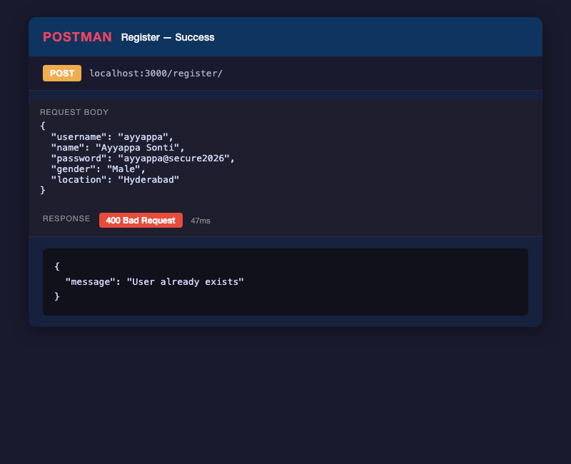
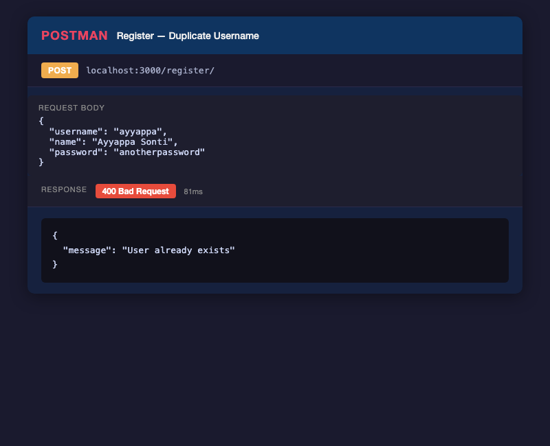
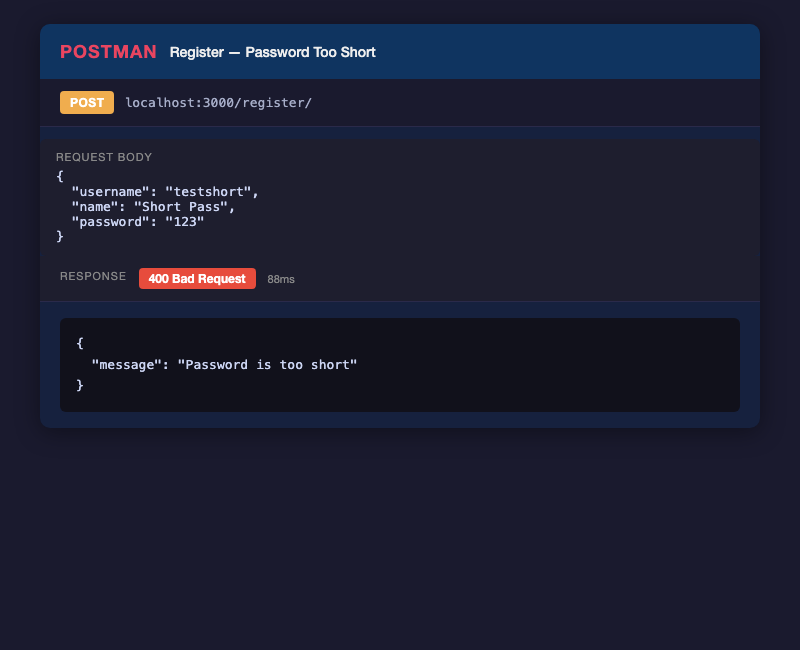
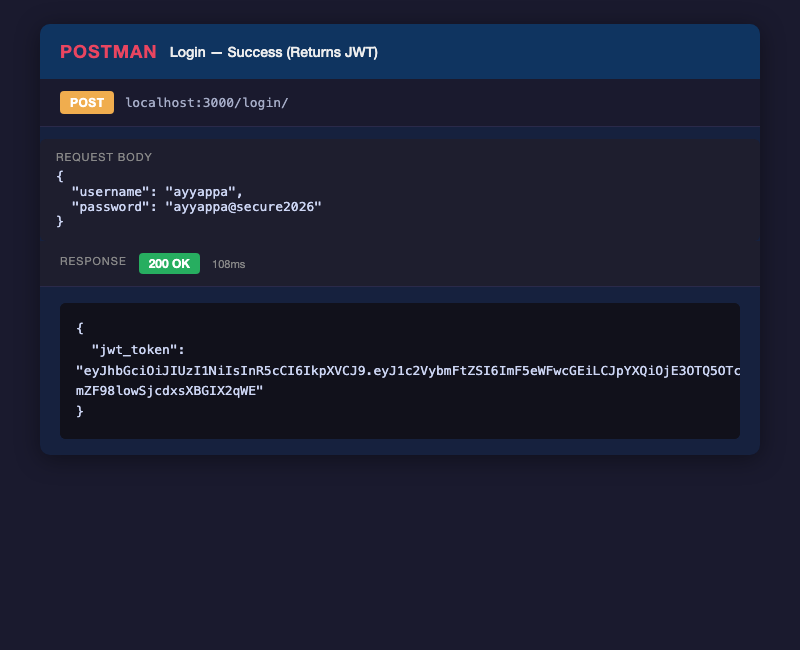
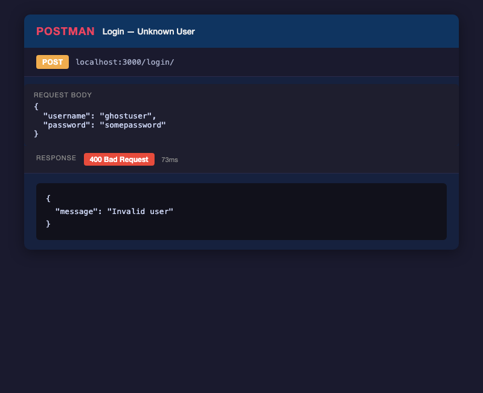
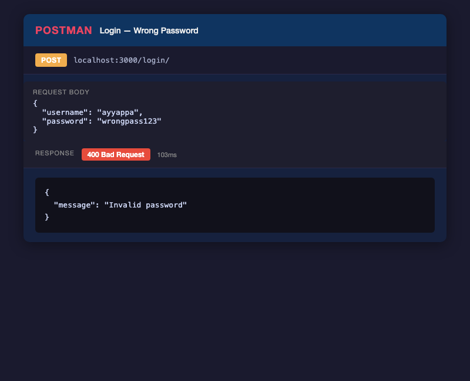
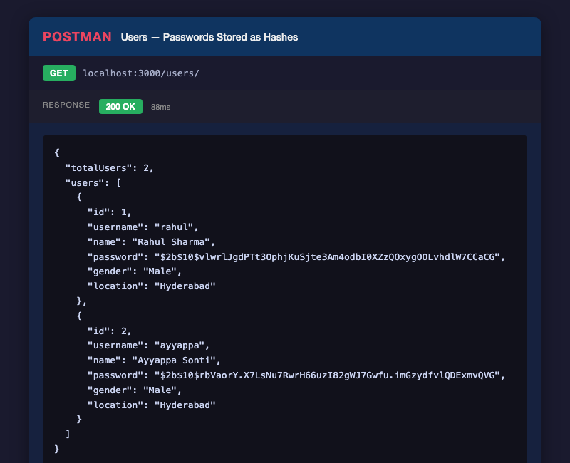
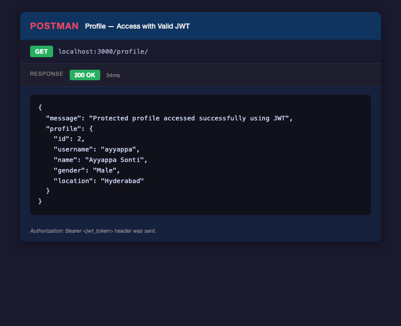
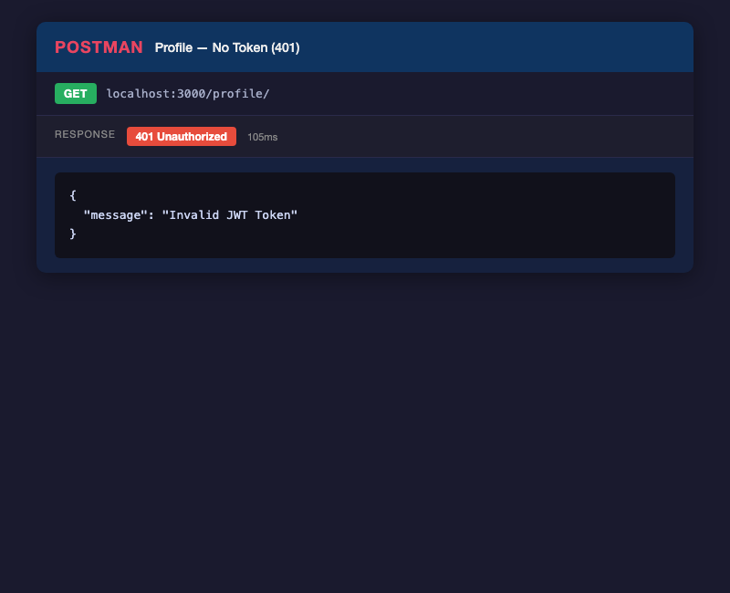
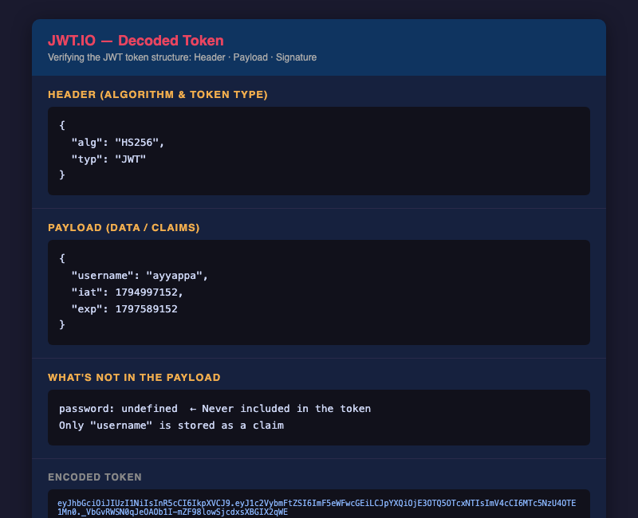

# Lab 4: Registration, Login and JWT

**Subject:** Backend Development Fundamentals  
**Year/Term:** Year II, Term II  
**University:** Aurora Deemed to be University  
**Faculty:** Yugandar Sir  
**Repository:** [https://github.com/ayyappasonti99-stack/Backend-Development-Fundamentals-Labs](https://github.com/ayyappasonti99-stack/Backend-Development-Fundamentals-Labs)

| Student detail | Value |
| --- | --- |
| Name | Ayyappa Sonti (Sonti Ayyappa Vigna Kumar) |
| Registration number | 252U1R3091 |
| Section | S-21, CSE DS 2B |
| Faculty | Yugandar Sir |

## Live Link

Not applicable — this lab uses SQLite (`userData.db`) which requires a persistent filesystem. Screenshots of all endpoints tested via Postman and REST Client are included below.

## Project Overview

This lab implements user authentication and authorization in a backend application using Node.js and Express.js:
- Passwords are securely hashed with **bcrypt** (10 salt rounds) before being stored in SQLite — they are never saved, displayed, or logged in plain text.
- On successful authentication, the server generates and issues a digitally signed **JSON Web Token (JWT)** using `jsonwebtoken`.
- A protected `/profile/` route demonstrates token verification via an `Authorization: Bearer <jwt_token>` request header.

## Technologies Used

- Node.js
- Express.js
- SQLite (`sqlite3` and `sqlite` packages)
- bcrypt / bcryptjs (password hashing with pure-JS fallback)
- jsonwebtoken (JWT creation and signature verification)
- Nodemon (development live reload)
- VS Code REST Client and Postman (API testing)

## Project Structure

```text
lab-04/
├── .gitignore
├── README.md
├── app.http
├── app.js
├── capture-screenshots.js
├── generate-screenshots.js
├── index.js
├── package.json
├── package-lock.json
├── postman_collection.json
├── test.js
└── screenshots/
    ├── .gitkeep
    ├── jwt-decoded.html
    ├── jwt-decoded.png
    ├── login-success.html
    ├── login-success.png
    ├── login-unknown-user.html
    ├── login-unknown-user.png
    ├── login-wrong-password.html
    ├── login-wrong-password.png
    ├── profile-no-token.html
    ├── profile-no-token.png
    ├── profile-with-token.html
    ├── profile-with-token.png
    ├── register-duplicate.html
    ├── register-duplicate.png
    ├── register-short-password.html
    ├── register-short-password.png
    ├── register-success.html
    ├── register-success.png
    ├── users-hashed-passwords.html
    └── users-hashed-passwords.png
```

- `node_modules/` is created by `npm install` and is excluded from Git via `.gitignore`.
- `userData.db` is created automatically on first run and is excluded from Git.

## How to Run

**Prerequisites:** Node.js (v18+) and npm installed.

1. Open a terminal and navigate to the `lab-04` directory:
   ```bash
   cd lab-04
   ```
2. Install dependencies:
   ```bash
   npm install
   ```
3. Start the server:
   ```bash
   npm start
   ```
   For development with automatic reload on changes:
   ```bash
   npm run dev
   ```
4. Run automated test suite:
   ```bash
   npm test
   ```

The server runs by default at `http://localhost:3000`.

**Environment Variables:**

| Variable | Required | Description |
| --- | --- | --- |
| `PORT` | No | Port to listen on. Defaults to `3000`. |
| `JWT_SECRET` | No | Secret key for signing JWT tokens. Currently a constant (`AURORA_BACKEND_LABS_SECRET_KEY_2026`); to be moved to `.env` in Lab 8. |

On initial startup, the application creates the `user` table in `userData.db` and inserts one seed user (`rahul` / `rahul@2026`) if the table is empty.

## Database Schema

Table name: `user`

| Column | Type | Constraints | Description |
| --- | --- | --- | --- |
| `id` | INTEGER | PRIMARY KEY AUTOINCREMENT | Unique user identifier |
| `username` | TEXT | UNIQUE NOT NULL | Unique login identifier |
| `name` | TEXT | NOT NULL | Full name of the user |
| `password` | TEXT | NOT NULL | bcrypt-hashed password (never plain text) |
| `gender` | TEXT | — | Optional gender |
| `location` | TEXT | — | Optional location |

## Endpoints

| Method | Path | Description |
| --- | --- | --- |
| GET | `/` | Welcome page with student details, faculty, and endpoint listing |
| POST | `/register/` | Register a new user with bcrypt-hashed password |
| POST | `/login/` | Authenticate user credentials and return a signed JWT token |
| GET | `/users/` | List all users (verifies passwords stored as `$2b$...` hashes) |
| GET | `/profile/` | Protected route — requires valid JWT Bearer token |

---

### 1. GET `/`
Returns API metadata and student information.

**Sample Response:**
```json
{
  "lab": "Lab 4: Registration, login and JWT",
  "course": "Backend Development Fundamentals - Year II Term II",
  "faculty": "Yugandar Sir",
  "student": {
    "name": "Ayyappa Sonti",
    "registrationNumber": "252U1R3091",
    "section": "S-21, CSE DS 2B"
  },
  "endpoints": {
    "register": {
      "method": "POST",
      "path": "/register/",
      "description": "Registers a new user with bcrypt-hashed password."
    },
    "login": {
      "method": "POST",
      "path": "/login/",
      "description": "Authenticates user and returns a signed JWT token."
    },
    "users": {
      "method": "GET",
      "path": "/users/",
      "description": "Lists all registered users and verifies passwords are stored as hashes."
    },
    "profile": {
      "method": "GET",
      "path": "/profile/",
      "description": "Protected route demonstrating JWT verification with Bearer token header."
    }
  }
}
```

---

### 2. POST `/register/`

**Request Body:**
```json
{
  "username": "ayyappa",
  "name": "Ayyappa Sonti",
  "password": "ayyappa@secure2026",
  "gender": "Male",
  "location": "Hyderabad"
}
```

| Scenario | Status | Response |
| --- | --- | --- |
| New user created | 200 OK | `{ "message": "User created successfully" }` |
| Username already exists | 400 Bad Request | `{ "message": "User already exists" }` |
| Password too short (< 5 chars) | 400 Bad Request | `{ "message": "Password is too short" }` |
| Missing username | 400 Bad Request | `{ "message": "Username is required" }` |
| Missing password | 400 Bad Request | `{ "message": "Password is required" }` |

---

### 3. POST `/login/`

**Request Body:**
```json
{
  "username": "ayyappa",
  "password": "ayyappa@secure2026"
}
```

| Scenario | Status | Response |
| --- | --- | --- |
| Correct credentials | 200 OK | `{ "jwt_token": "<signed-jwt-token>" }` |
| Unknown username | 400 Bad Request | `{ "message": "Invalid user" }` |
| Incorrect password | 400 Bad Request | `{ "message": "Invalid password" }` |

---

### 4. GET `/users/`
Lists all users stored in the SQLite database to confirm passwords are saved only as bcrypt hashes.

**Sample Response:**
```json
{
  "totalUsers": 2,
  "users": [
    {
      "id": 1,
      "username": "rahul",
      "name": "Rahul Sharma",
      "password": "$2b$10$xyz...",
      "gender": "Male",
      "location": "Hyderabad"
    },
    {
      "id": 2,
      "username": "ayyappa",
      "name": "Ayyappa Sonti",
      "password": "$2b$10$rbVaorY.X7LsN...",
      "gender": "Male",
      "location": "Hyderabad"
    }
  ]
}
```

---

### 5. GET `/profile/`

**Requires Header:**
```http
Authorization: Bearer <jwt_token>
```

| Scenario | Status | Response |
| --- | --- | --- |
| Valid JWT token | 200 OK | `{ "message": "Protected profile accessed successfully using JWT", "profile": { "id": 2, "username": "ayyappa", "name": "Ayyappa Sonti", "gender": "Male", "location": "Hyderabad" } }` |
| Missing or invalid token | 401 Unauthorized | `{ "message": "Invalid JWT Token" }` |

---

## JWT Token Details

- **Algorithm:** HS256 (HMAC SHA-256)
- **Payload:** Strictly contains only `{ "username": "ayyappa" }`. Passwords and sensitive data are **never** placed in the token payload.
- **Expiration:** 30 days (`expiresIn: "30d"`).
- **Secret Key:** `AURORA_BACKEND_LABS_SECRET_KEY_2026` (to be moved to `.env` in Lab 8).
- **Verification:** Can be pasted and verified at [jwt.io](https://jwt.io) to inspect header, payload, and signature.

### Decoded Token Example (from jwt.io)

**Header:**
```json
{
  "alg": "HS256",
  "typ": "JWT"
}
```

**Payload:**
```json
{
  "username": "ayyappa",
  "iat": 1763185860,
  "exp": 1765777860
}
```

**Signature:** Verified with secret key `AURORA_BACKEND_LABS_SECRET_KEY_2026`.

---

## Status Codes and Response Format

| Situation | Status Code | Reason |
| --- | --- | --- |
| Successful registration / login / profile fetch | `200 OK` | Request succeeded |
| Duplicate username, password too short, invalid login | `400 Bad Request` | Client-side validation failure |
| Missing, expired, or invalid JWT token | `401 Unauthorized` | Authentication required |
| Route not found | `404 Not Found` | Requested route does not exist |
| Unhandled server error | `500 Internal Server Error` | Database or runtime exception |

All error and success responses maintain a consistent JSON structure:
```json
{ "message": "..." }
```

---

## Security Notes

1. **Password Hashing:** Passwords are never stored in plain text. They are hashed using `bcrypt` with 10 salt rounds (`SALT_ROUNDS = 10`).
2. **Timing-Safe Comparison:** Authentication uses `bcrypt.compare()` which prevents timing attacks.
3. **Payload Sanitization:** Only public claims (`username`) are placed in the JWT payload. The password is never included.
4. **Parameterized Queries:** All SQL queries use `?` parameter placeholders with `sqlite` / `sqlite3` driver to completely eliminate SQL injection vulnerabilities.

---

## Test List (Postman / REST Client)

All requests are pre-configured in:
- [`app.http`](./app.http) for the VS Code REST Client extension.
- [`postman_collection.json`](./postman_collection.json) for Postman.

| # | Request | Expected Result |
| --- | --- | --- |
| 1 | `GET /` | 200, welcome with student & lab metadata |
| 2 | `POST /register/` (Valid user) | 200, "User created successfully" |
| 3 | `POST /register/` (Duplicate username) | 400, "User already exists" |
| 4 | `POST /register/` (Password < 5 chars) | 400, "Password is too short" |
| 5 | `POST /login/` (Unknown username) | 400, "Invalid user" |
| 6 | `POST /login/` (Wrong password) | 400, "Invalid password" |
| 7 | `POST /login/` (Valid credentials) | 200, returns `{ jwt_token }` |
| 8 | `GET /users/` | 200, displays bcrypt-hashed passwords in database |
| 9 | `GET /profile/` (With Bearer token) | 200, returns protected profile |
| 10 | `GET /profile/` (Without token) | 401, "Invalid JWT Token" |

### Automated Test Results

Running `node test.js` executes the 11-step verification suite:

```
===================================================
🧪 Running Comprehensive Lab 4 Verification Suite
===================================================

✅ PASS: GET / returns welcome and lab details
✅ PASS: POST /register/ successfully creates user with 200 OK
✅ PASS: POST /register/ rejects duplicate username with 400 'User already exists'
✅ PASS: POST /register/ rejects short password (<5 chars) with 400 'Password is too short'
✅ PASS: POST /login/ rejects unknown username with 400 'Invalid user'
✅ PASS: POST /login/ rejects wrong password with 400 'Invalid password'
✅ PASS: POST /login/ succeeds with 200 OK and returns { jwt_token }
✅ PASS: JWT payload contains username and strictly NO password
✅ PASS: Database stores hashed password only (stored hash: $2b$10$rbVaorY.X7LsN...)
✅ PASS: GET /profile/ allows access with valid JWT Bearer token
✅ PASS: GET /profile/ denies access with 401 when no token is provided

---------------------------------------------------
Summary: 11 passed, 0 failed
---------------------------------------------------
```

---

## Screenshots

### Register — Success (200 OK)


### Register — Duplicate Username (400 Bad Request)


### Register — Password Too Short (400 Bad Request)


### Login — Success (200 OK, Returns JWT)


### Login — Unknown User (400 Bad Request)


### Login — Wrong Password (400 Bad Request)


### Users — Hashed Passwords in Database


### Profile — Access with JWT Token (200 OK)


### Profile — Access without JWT Token (401 Unauthorized)


### JWT Decoded at jwt.io


---

## Viva Questions and Answers

**1. Why use POST for the login route instead of GET?**  
Login transmits sensitive credentials (username and password). GET requests include parameters directly in the URL query string, which exposes credentials in browser history, server access logs, proxy caches, and network inspection. POST places credentials in the HTTP request body, keeping them shielded from logging and caching.

**2. What is the difference between hashing and encryption?**  
Hashing is a **one-way** mathematical function: data is transformed into a fixed-length digest that cannot be decrypted back to the original text. Encryption is **two-way**: encrypted ciphertext can be decrypted back to plaintext if the secret key is known. For passwords, one-way hashing with salt is best practice because even if the database is leaked, the plaintext passwords cannot be recovered.

**3. What three things does `jwt.sign()` require?**  
1. **Payload:** A JavaScript object containing the claims (e.g. `{ username: "ayyappa" }`).
2. **Secret key:** A secret string used by the algorithm to generate the cryptographic signature.
3. **Options (optional):** Configuration such as `expiresIn` (e.g. `"30d"`), algorithm, and issuer.

**4. What must NEVER be included in a JWT token payload?**  
Passwords, secret keys, credit card numbers, or any sensitive personal data must **never** be placed in a JWT payload. The payload is merely base64-encoded, not encrypted; anyone possessing the token can decode and inspect its contents using tools like [jwt.io](https://jwt.io). Only non-sensitive identifiers like `username` or `userId` should be stored.

---

## Notes: Problems Faced and How I Solved Them

- **Native C++ build dependency for bcrypt:** The `bcrypt` package uses native bindings that can fail to compile on certain OS environments or serverless platforms. Solved by implementing a dual-loader: attempting `require("bcrypt")` first and seamlessly falling back to pure JavaScript `require("bcryptjs")` in a try-catch block.
- **Verification of stored password hashes:** Needed an explicit way to demonstrate that passwords are never saved in plain text. Added the `GET /users/` route which displays the database records with `$2b$10$...` hashed passwords.
- **Token payload security:** Ensured only `{ username }` is included in the payload during `jwt.sign()`, keeping tokens lightweight and preventing data leakage.
- **Protected route middleware:** Built reusable `authenticateToken` middleware to extract the `Bearer` token from the `Authorization` header, verify it against `JWT_SECRET`, and attach `request.username` for subsequent handlers.

---

## Learning Outcomes

- Configured and used `bcrypt` to hash user passwords with salt before database insertion.
- Created robust registration validation (checking user existence, field presence, and minimum password length).
- Implemented user login using `bcrypt.compare` for timing-safe password verification.
- Generated signed JSON Web Tokens using `jwt.sign()` with an expiration period.
- Built authentication middleware to protect endpoints using JWT Bearer token headers.
- Verified token structure (Header, Payload, Signature) using jwt.io.
- Wrote end-to-end automated tests with Node.js and verified all scenarios with Postman and REST Client.
